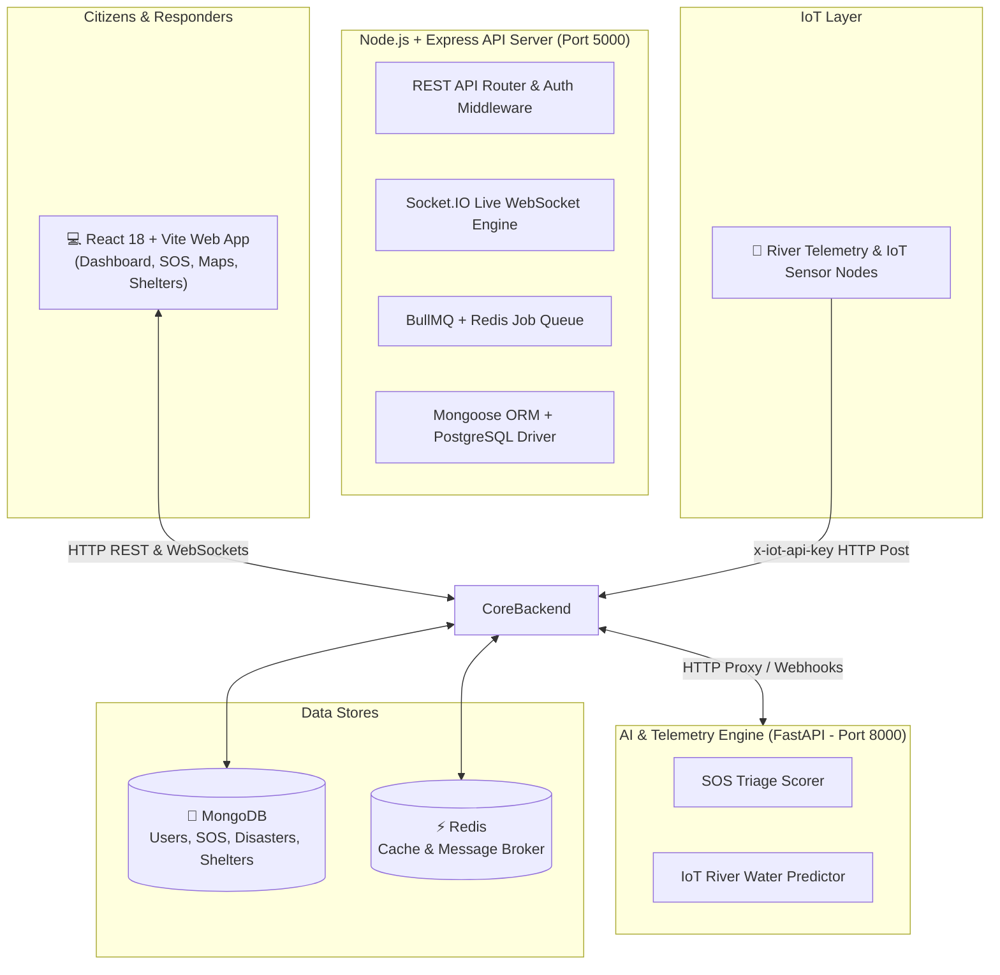

# 🌐 SafeSphere — Intelligent Disaster Management & Emergency Coordination Platform

[](https://www.typescriptlang.org/)
[](https://react.dev/)
[](https://vitejs.dev/)
[](https://nodejs.org/)
[](https://fastapi.tiangolo.com/)
[](https://www.mongodb.com/)
[](https://socket.io/)
[](LICENSE)

> **SafeSphere** (also referred to as *DisasterConnect*) is an end-to-end emergency management and crisis response platform. It unifies citizens, emergency dispatchers, first responders, and government relief agencies into a single, synchronized operational ecosystem during natural and humanitarian disasters.

---

## 📌 Table of Contents

- [Vision & Key Highlights](#-vision--key-highlights)
- [System Architecture](#-system-architecture)
- [Core Features & Modules](#-core-features--modules)
- [Tech Stack](#-tech-stack)
- [Project Directory Structure](#-project-directory-structure)
- [Getting Started & Local Setup](#-getting-started--local-setup)
  - [Prerequisites](#prerequisites)
  - [1. Backend Setup](#1-backend-setup)
  - [2. Frontend Setup](#2-frontend-setup)
  - [3. AI Engine Setup](#3-ai-engine-setup)
  - [Database Seeding](#database-seeding)
- [Environment Configuration](#-environment-configuration)
- [API & Microservice Endpoints](#-api--microservice-endpoints)
- [Role-Based Access Control (RBAC)](#-role-based-access-control-rbac)
- [Docker Deployment](#-docker-deployment)
- [Contributing & License](#-contributing--license)

---

## 🌟 Vision & Key Highlights

During critical disasters (floods, building collapses, fires, cyclones), lack of coordination and fragmented information cost lives. **SafeSphere** tackles this by pairing **real-time IoT river/sensor telemetry** and **AI triage heuristics** with **interactive geospatial mapping**:

- ⚡ **Rapid SOS Signal Processing**: Direct distress signaling with GPS geocoding and survivor headcounts.
- 🤖 **Automated Triage & Squad Dispatch**: The AI engine scores hazard severity (0–100) and automatically routes dispatch to the right squad (e.g., NDRF Search & Rescue, National Water Rescue, or City Fire Department).
- 🌊 **IoT Flood Forecasting**: Continuously tracks river water sensors against critical thresholds to broadcast alerts before breaches occur.
- 🗺️ **GIS Common Operational Picture**: Single-pane dashboard powered by Leaflet to monitor shelters, active disaster zones, rescue squads, and resources.

---

## 🏗️ System Architecture



---

## 🚀 Core Features & Modules

### 🚨 1. SOS Distress Signaling & AI Triage
- Instant SOS reporting with GPS position, description, required aid type, and number of trapped individuals.
- Microservice evaluates text content for collapse, fire, water inundation, and crowd size to assign calculated hazard scores and recommended tactical units.

### 🌊 2. IoT Telemetry & Automated Flood Warning
- Ingests water level sensor metrics (`waterLevelCm`, `criticalThresholdCm`, sensor GPS).
- Triggers automatic high-priority disaster warnings and emergency notifications when flood levels breach danger thresholds.

### 🗺️ 3. Interactive GIS Command Dashboard
- Live Leaflet map visualization displaying active incident epicenters, severity heatmaps, evacuee shelters, and assigned rescue teams.
- Real-time updates pushed seamlessly via **Socket.IO**.

### 👥 4. Missing Persons Registry
- Citizen submission portal for reporting missing family and community members.
- Includes photo attachments, biometric/identifying descriptions, last-known locations, and contact logs.

### 🏥 5. Shelter & Evacuation Management
- Live monitoring of evacuation shelter facilities, total capacity, real-time occupancy, and available utilities (medical, power, sanitation).
- Coordinates routing of evacuees to nearest undersaturated facilities.

### 📦 6. Resource & Relief Supply Allocation
- Inventory tracker for medical kits, clean water, rations, rescue boats, and temporary bedding.
- Tracks dispatch of logistics from central warehouses to disaster relief centers.

### 🚒 7. Rescue Team & Squad Coordination
- Manage teams across multiple specializations (NDRF, SDRF, Medical, Paramedics, Volunteer corps).
- Status assignment lifecycle (`standby`, `deployed`, `en_route`, `completed`).

---

## 🛠️ Tech Stack

| Domain | Technology | Description |
| :--- | :--- | :--- |
| **Frontend** | **React 18** | UI framework with component architecture |
| | **TypeScript** | Type-safe enterprise JavaScript |
| | **Vite** | Ultra-fast next-gen build tool & dev server |
| | **Leaflet & React-Leaflet** | Interactive geospatial mapping & markers |
| | **Recharts** | Real-time analytics, graphs, and metric dashboards |
| | **Lucide React** | Modern, clean UI iconography |
| | **Formik & Yup** | Robust form validation and submission schemas |
| | **Socket.IO Client** | Bi-directional WebSocket event subscription |
| **Backend API** | **Node.js & Express** | RESTful HTTP service and controller pipeline |
| | **TypeScript & ts-node** | Fully typed server-side code |
| | **Socket.IO** | Real-time emergency broadcast layer |
| | **Mongoose (MongoDB)** | Document database for flexible disaster schemas |
| | **PostgreSQL (`pg`)** | Relational transactional management |
| | **BullMQ & Redis** | Background queue processing & worker scheduling |
| | **Multer** | Multi-part file and photo upload handler |
| | **Helmet & Morgan** | HTTP security headers and structured logging |
| **AI Engine** | **FastAPI** | High-performance Python microservice |
| | **Uvicorn** | Lightning-fast ASGI web server |
| | **Pydantic** | Strict data validation and schema declaration |
| | **Scikit-Learn & NumPy** | Statistical heuristics and hazard models |

---

## 📂 Project Directory Structure

```text
SafeSphere/
├── SafeSphere/
│   ├── backend/                     # Node.js Express REST API & WebSockets
│   │   ├── src/
│   │   │   ├── config/              # DB and third-party configurations
│   │   │   ├── controllers/         # Route controllers & business logic
│   │   │   ├── middleware/          # JWT auth, RBAC, error handlers
│   │   │   ├── models/              # Mongoose schemas (Disaster, SOS, User, etc.)
│   │   │   ├── queues/              # BullMQ queue definitions
│   │   │   ├── routes/              # Express API route endpoints
│   │   │   ├── seed/                # DB seeding scripts (Scenario, Users)
│   │   │   ├── services/            # Core domain services
│   │   │   └── workers/             # Background task workers
│   │   ├── package.json
│   │   ├── tsconfig.json
│   │   └── Dockerfile
│   │
│   ├── frontend/                    # React 18 + Vite Web Application
│   │   ├── public/                  # Static assets & icons
│   │   ├── src/
│   │   │   ├── components/          # Reusable UI widgets & layouts
│   │   │   ├── context/             # Global Auth & Socket contexts
│   │   │   ├── pages/               # Dashboard, SOS, Shelters, Teams, Alerts
│   │   │   ├── services/            # Axios API clients
│   │   │   └── types/               # TypeScript interfaces & types
│   │   ├── index.html
│   │   ├── vite.config.ts
│   │   ├── package.json
│   │   └── Dockerfile
│   │
│   ├── ai-engine/                   # Python FastAPI AI Triage & Telemetry Service
│   │   ├── main.py                  # API routes (/api/triage, /api/predict-flood)
│   │   ├── requirements.txt         # Python dependencies
│   │   └── Dockerfile
│   │
│   └── DisasterConnect_Project_Scope.pdf # Complete system specification
└── README.md
```

---

## ⚡ Getting Started & Local Setup

### Prerequisites
Make sure you have the following installed on your machine:
* **Node.js** (v18.x or v20.x recommended)
* **npm** (v9.x or higher)
* **Python** (v3.10 to v3.13)
* **MongoDB** (Local instance running on `localhost:27017` or MongoDB Atlas URI)
* **Redis** (Optional, for BullMQ queues)

---

### 1. Backend Setup

```bash
# Navigate to the backend directory
cd SafeSphere/SafeSphere/backend

# Create .env configuration
copy .env.example .env

# Install dependencies (already installed if using automated setup)
npm install

# Run database seeds (optional, to seed demo users, scenarios, and districts)
npm run seed:users
npm run seed:disasters
npm run seed:scenario

# Start backend in development mode (with nodemon)
npm run dev
```
*Backend server will listen on:* `http://localhost:5000`

---

### 2. Frontend Setup

In a new terminal window:

```bash
# Navigate to the frontend directory
cd SafeSphere/SafeSphere/frontend

# Create .env configuration
copy .env.example .env

# Install dependencies
npm install

# Start Vite development server
npm run dev
```
*Frontend application will be accessible at:* `http://localhost:3000` (or `http://localhost:5173`)

---

### 3. AI Engine Setup

In a new terminal window:

```bash
# Navigate to the AI engine directory
cd SafeSphere/SafeSphere/ai-engine

# Create and activate Python virtual environment
python -m venv venv

# Windows:
.\venv\Scripts\activate
# Linux/macOS:
# source venv/bin/activate

# Install dependencies
pip install -r requirements.txt

# Start FastAPI server
uvicorn main:app --reload --port 8000
```
*AI Microservice will be running on:* `http://localhost:8000` (Interactive Swagger docs at `http://localhost:8000/docs`)

---

## 🔑 Environment Configuration

### Backend (`backend/.env`)
| Variable | Description | Default |
| :--- | :--- | :--- |
| `PORT` | HTTP port for the Express API | `5000` |
| `MONGODB_URI` | MongoDB connection string | `mongodb://localhost:27017/disasterconnect` |
| `JWT_SECRET` | Secret key for JWT signing & verification | `YOUR_SUPER_SECRET_JWT_KEY` |
| `JWT_EXPIRES_IN` | Token validity duration | `7d` |
| `CLIENT_URL` | Frontend origin for CORS policy | `http://localhost:3000` |
| `IOT_API_KEY` | Secret authentication key for IoT nodes | `REPLACE_WITH_A_LONG_RANDOM_IOT_DEVICE_KEY` |

### Frontend (`frontend/.env`)
| Variable | Description | Default |
| :--- | :--- | :--- |
| `VITE_API_BASE_URL` | Root URL for backend REST API | `http://localhost:5000/api` |
| `VITE_GOOGLE_MAPS_KEY`| (Optional) Google Maps API key | — |

---

## 📡 API & Microservice Endpoints

### Core Backend (`http://localhost:5000/api`)
- `POST /auth/register` & `POST /auth/login` — Authentication & JWT tokens.
- `GET /disasters` & `POST /disasters` — List active disasters and report incidents.
- `POST /disasters/auto` — Machine-to-machine route for IoT automated disaster alerts.
- `GET /sos` & `POST /sos` — Emergency distress dispatch and geolocation.
- `GET /shelters` & `POST /shelters` — Evacuation shelter capacities and check-in.
- `GET /missing-persons` & `POST /missing-persons` — Community missing person registry.
- `GET /teams` & `POST /teams` — Rescue unit dispatch and status updates.
- `GET /resources` — Aid, ration, and equipment inventories.
- `POST /iot/telemetry` — Water level telemetry ingestion from river sensors.

### AI Engine (`http://localhost:8000`)
- `POST /api/triage` — Evaluates SOS message text, severity, hazards, and squad recommendations.
- `POST /api/predict-flood` — Calculates flood inundation ratio and automatically posts alerts to Node.js API when critical.

---

## 🛡️ Role-Based Access Control (RBAC)

SafeSphere enforces role-scoped capabilities:
- **`citizen`**: Submit SOS alerts, search missing family members, find closest shelters, view public alerts.
- **`responder`**: Update rescue status, accept assigned distress tickets, report on-site conditions.
- **`coordinator`**: Dispatch rescue teams, allocate resource supplies, update shelter occupancy.
- **`admin`**: Full platform authority, user management, IoT sensor authorization, broadcast emergency alert system.

---

## 🐳 Docker Deployment

Every service comes with its own multi-stage `Dockerfile`:

```bash
# Build Backend image
docker build -t safesphere-backend ./SafeSphere/backend

# Build Frontend image
docker build -t safesphere-frontend ./SafeSphere/frontend

# Build AI Engine image
docker build -t safesphere-ai ./SafeSphere/ai-engine
```

---

## 🤝 Contributing

Contributions, issues, and feature requests are welcome!
1. Fork the Project.
2. Create your Feature Branch (`git checkout -b feature/AmazingFeature`).
3. Commit your Changes (`git commit -m 'Add some AmazingFeature'`).
4. Push to the Branch (`git push origin feature/AmazingFeature`).
5. Open a Pull Request.

---

## 📄 License

This project is licensed under the **ISC License**.
